# Currículo sob medida

Um aplicativo que roda **no seu computador** e faz duas coisas:

1. **Entrevista você** por chat para descobrir, com precisão, o que você já fez na vida profissional, e guarda isso numa base de fatos em arquivos de texto.
2. **Monta um currículo para cada vaga.** Você cola a descrição da vaga, o aplicativo mostra o que a sua base comprova e o que é lacuna, pergunta o que falta e gera o currículo em português ou inglês, em PDF e DOCX, com formatação simples para sistemas de triagem (ATS).

A regra central do projeto, imposta por código e não só pedida à IA:

> **Nada entra no currículo sem um fato que você confirmou.** A IA pode sugerir, reformular e traduzir. Só você decide o que é verdade.

## O que ele não faz

- **Não promete que o currículo vai passar em nenhum ATS.** O que ajuda de verdade é usar o vocabulário exato da vaga nos pontos em que ele é verdade para você, e um recrutador de carne e osso ainda lê o resultado.
- **Não inventa experiência para cobrir uma lacuna.** Se a vaga pede algo que você não tem, o aplicativo mostra a lacuna e deixa de fora do currículo.
- **Não baixa vagas por link.** Os sites bloqueiam isso. Copie e cole o texto da vaga.
- **Não é infalível.** A IA pode errar mesmo com as travas. Leia o currículo inteiro e os alertas antes de enviar.

## Privacidade: o que sai do seu computador

| Fica só no seu computador | É enviado ao provedor de IA |
|---|---|
| Nome, telefone, e-mail, links e endereço (arquivo `base/contato.yaml`) | O que você escreve no chat |
| A sua base de fatos (pasta `base/`) | Os fatos confirmados que o aplicativo usa para analisar e gerar |
| Os currículos gerados (pasta `saidas/`) | O texto da vaga e do currículo importado |
| A conversa em andamento (`base/.sessao/`) e o registro das chamadas à IA (`saidas/logs/`, sem contato) | |
| A sua chave de API (arquivo `.env`) | |

Antes de qualquer envio, o aplicativo **mascara e-mails, telefones e links** e remove do texto os valores do seu cadastro de contato (incluindo o seu nome). O cabeçalho do currículo é montado localmente, depois da geração. Mesmo assim, **não digite telefone, endereço ou documentos no chat.**

O provedor de IA usado é o **DeepSeek**, e os servidores dele ficam na China. Saiba disso antes de enviar qualquer informação.

---

## Instalação, sem usar terminal

Você precisa de internet (na primeira vez para baixar as peças do aplicativo, e depois para falar com a IA) e de uma **chave de API do DeepSeek** (veja a próxima seção).

### Windows

1. **Instale o Python.** Entre em [python.org/downloads](https://www.python.org/downloads/), baixe a versão mais recente e abra o instalador. Na **primeira tela**, antes de clicar em *Install Now*, marque a caixa **"Add python.exe to PATH"**. Esse é o passo que mais dá problema quando esquecido.
2. **Baixe o aplicativo.** Na página do projeto no GitHub, clique no botão verde **Code** e depois em **Download ZIP**. Clique com o botão direito no arquivo baixado, escolha **Extrair tudo** e deixe a pasta num lugar fácil, como Documentos.
3. **Tenha a chave em mãos** (próxima seção).
4. **Dê dois cliques em `iniciar.bat`.**
   - Na primeira vez, ele prepara tudo sozinho. Isso leva alguns minutos.
   - Se o Windows mostrar "O Windows protegeu seu computador", clique em **Mais informações** e depois em **Executar assim mesmo**. O arquivo é só texto: dá para abrir no Bloco de Notas e ler antes.
5. **Cole a chave.** O Bloco de Notas abre com o arquivo `.env`. Cole a chave logo depois de `DEEPSEEK_API_KEY=`, sem espaços e sem aspas. Salve e feche o Bloco de Notas.
6. O navegador abre sozinho com o aplicativo. **Para encerrar, feche a janela preta.**

Nas próximas vezes, basta dar dois cliques em `iniciar.bat`.

### Linux

```bash
sudo apt install python3 python3-venv python3-pip   # ou o equivalente da sua distribuição
bash iniciar.sh
```

Na primeira execução o script cria o arquivo `.env` e abre um editor. Cole a chave depois de `DEEPSEEK_API_KEY=`, salve e rode `bash iniciar.sh` de novo.

### Mac

Não há script próprio, e eu não testei em Mac. `bash iniciar.sh` deve funcionar depois de instalar o Python em python.org.

### Conferir se está tudo certo

Numa janela de terminal na pasta do aplicativo:

```bash
python verificar.py            # Windows: .venv\Scripts\python verificar.py
python verificar.py --modelos  # lista os modelos que a sua chave enxerga
```

Ele confere o Python, os pacotes, as pastas, a geração de PDF e DOCX, a conexão com o provedor e se o modelo devolve JSON. Cada problema aparece como `[FALHOU]`, com a dica do que fazer.

### Atualizações

**Você não precisa fazer nada.** Sempre que você abre o aplicativo pelo `iniciar.bat` (ou `iniciar.sh`), ele confere se há uma versão nova publicada. Se houver, ele:

1. guarda uma cópia do aplicativo atual e uma do seu histórico na pasta `backups/` (as 3 mais recentes);
2. baixa a versão nova e troca só os arquivos do aplicativo;
3. instala bibliotecas novas, se a versão pedir;
4. abre normalmente e mostra, uma vez, "atualizado para a versão X" com o que mudou.

**O seu histórico (`base/`), os seus currículos (`saidas/`) e a sua chave (`.env`) nunca são tocados.** Se algo der errado no meio, o aplicativo desfaz a troca sozinho e abre na versão de antes. Sem internet, ele só abre na versão que você tem. A versão instalada aparece no botão de engrenagem.

Na primeira vez, se a sua cópia é anterior a esta função, baixe o aplicativo de novo pelo GitHub (botão verde **Code**, **Download ZIP**) e copie para a pasta nova as pastas `base/` e `saidas/` e o arquivo `.env` da pasta antiga. Daí em diante, as atualizações são automáticas.

---

## Configurando a chave de API (arquivo `.env`)

O aplicativo usa o **DeepSeek**. Ele é pago, mas muito barato: um currículo custa centavos. Você pode usar a sua própria chave (crie em [platform.deepseek.com/api_keys](https://platform.deepseek.com/api_keys), depois de colocar um pequeno saldo na conta) ou uma chave que alguém de confiança passou para você.

A chave é como uma senha: quem tem a chave gasta o saldo de quem a criou. Por isso:

- **Não publique, não poste e não coloque a chave em nenhum arquivo que vá para o GitHub.** O arquivo `.env` é ignorado pelo Git de propósito.
- Quem emprestou a chave pode **apagá-la a qualquer momento** na página de chaves do DeepSeek. Se o aplicativo parar de funcionar com "A chave de API foi recusada", provavelmente foi isso.

### Como criar o `.env`

O `.env` é um arquivo de texto com a sua chave, que fica só no seu computador.

**Jeito fácil:** dê dois cliques em `iniciar.bat` (Windows) ou rode `bash iniciar.sh` (Linux). Se o `.env` ainda não existe, o script cria o arquivo a partir do modelo e abre o editor. Cole a chave, salve e feche.

**Jeito manual** (se preferir, ou se o editor não abriu):

1. Na pasta do aplicativo, ache o arquivo **`.env.example`**.
2. Faça uma **cópia** dele e renomeie a cópia para **`.env`** (exatamente assim, com o ponto no começo e sem `.example` no final).
   - No Windows, se o Explorador esconder as extensões, ative em *Exibir > Mostrar > Extensões de nomes de arquivos*. Se o Windows reclamar do nome, renomeie pelo Bloco de Notas: abra o `.env.example`, use *Arquivo > Salvar como*, escolha *Todos os arquivos* e digite `.env`.
3. Abra o `.env` no Bloco de Notas e deixe assim, trocando só o que vem depois de `DEEPSEEK_API_KEY=`:

```ini
PROVEDOR=deepseek
DEEPSEEK_API_KEY=cole_a_chave_aqui
MODELO=
```

4. **Sem espaços, sem aspas, sem quebra de linha** no meio da chave. Salve e feche.
5. Abra o aplicativo. Se aparecer uma tela dizendo que a IA ainda não está ligada, confira se o arquivo se chama mesmo `.env` (e não `.env.txt`) e se a chave está na linha `DEEPSEEK_API_KEY=`.

Para testar a chave sem abrir o aplicativo, numa janela de terminal na pasta do aplicativo: `python verificar.py` (Windows: `.venv\Scripts\python verificar.py`).

**Deixe `MODELO=` em branco**, a menos que quem emprestou a chave peça outro nome. Os nomes de modelos mudam com o tempo.

---

## Usando o aplicativo, passo a passo

Na primeira vez, o aplicativo abre numa tela de boas-vindas. Depois disso, ele abre sempre no **Início**, e o menu de cima tem **Início**, **Novo currículo**, **Minhas candidaturas** e **Meu histórico**. As configurações técnicas (provedor, teste de conexão, pastas) ficam no botão de engrenagem, no canto.

### Primeira vez: comece pelo currículo que você já tem

1. **Envie o seu currículo** (PDF, Word, Markdown ou texto). Pode ser simples ou desatualizado. **Envie um só, em um idioma só:** o aplicativo traduz na hora de gerar, e um segundo currículo em outro idioma só criaria repetições.
2. **Confira o que eu entendi.** Aparece tudo o que foi lido, aberto em cartões:
   - **Seus dados** (nome, título, cidade, telefone, e-mail, LinkedIn), já preenchidos. Eles são lidos no seu computador, nunca vão para a IA e entram só no topo do currículo.
   - **Cada experiência** num cartão, com cargo, empresa e datas editáveis e os itens marcados. As **sugestões da IA** vêm desmarcadas e com etiqueta: marque só se for verdade.
   - Um botão só: **Salvar**. O que está marcado entra no seu histórico. O que ficou desmarcado fica guardado como **a confirmar**, fora dos currículos, até você decidir.
3. Pronto: o histórico está montado, e o aplicativo leva você ao Início.

Se o currículo diz só o ano de uma experiência ("2016 – 2017"), fica só o ano: o aplicativo nunca inventa o mês. Se a IA tentar completar um mês que não está no texto, o código apaga e avisa.

Não tem currículo? Use **Começar conversando**. Só quer ver como funciona? **Usar dados de exemplo** carrega uma pessoa fictícia.

### Início: o que fazer agora

A tela de quem volta. De cima para baixo:

- **Duas ações:** **Currículo para uma vaga** (ou continuar a vaga que ficou pela metade) e **Currículo geral**.
- **Próximas ações**, cada uma com um botão: conferir uma leitura ou conversa pendente, preencher dados pessoais, revisar informações *a confirmar*, completar o histórico, marcar como enviados os currículos que você já mandou e **marcar como sem retorno** uma candidatura enviada há mais de 21 dias sem resposta. O aplicativo só sugere; nunca muda a situação sozinho.
- **Candidaturas:** quantas foram geradas, enviadas, viraram entrevista ou proposta, e quantas ficaram sem retorno. A **taxa de resposta** só aparece a partir de 5 candidaturas enviadas, e a **comparação entre aderência e resultado** só a partir de 20, rotulada como indício: com menos que isso, os números mudam demais a cada resposta e pareceriam uma conclusão sem ser.
- **Onde se desenvolver para aumentar suas chances:** o que mais se repete nas vagas em que você se candidatou (ou, antes de marcar alguma como enviada, nas vagas para as quais gerou currículo) e o seu histórico não mostra, do mais pedido para o menos, com os requisitos obrigatórios marcados. Dois caminhos: se você já tem e não contou, conte em Meu histórico; se ainda não tem, é por onde vale se desenvolver (um curso, um projeto, uma tarefa no trabalho atual), e até lá fica fora do currículo.
- Um lembrete para registrar resultados novos no emprego atual.

### Meu histórico

Tudo o que o aplicativo sabe sobre você, em quatro seções:

- **Visão geral:** cada experiência num cartão, com todos os itens à vista. **Editar** abre o cartão para mudar cargo, datas e itens (um por linha). Itens *a confirmar* aparecem com **Confirmar** e **Remover** ao lado. O quadro **O que ainda falta** lista o que deixaria o histórico mais forte (números, formação, idiomas) e leva à conversa. Se faltam seus dados pessoais, um aviso leva direto para eles.
- **Conversar para completar:** o entrevistador pergunta só o que falta, uma coisa por vez, sem repetir o que já está no histórico. Quando quiser, clique em **Salvar o que eu contei**: aparece a mesma conferência em cartões.
- **Dados pessoais:** nome, contato e links.
- **Avançado:** edição dos arquivos em texto e o registro das conversas com a IA.

Se um currículo ou uma conversa trouxer algo que **parece uma experiência que você já tem** (mesma empresa escrita de outro jeito, como "Mercado Livre" e "MercadoLibre", ou o mesmo período), a conferência avisa no cartão. Itens novos em outro idioma numa experiência existente também geram aviso: costumam ser os mesmos, só traduzidos.

### Novo currículo: para uma vaga

Três passos, com o indicador no topo:

1. **A vaga.** Cole o texto completo (ou envie um arquivo) e clique em **Analisar vaga**.
2. **Encaixe com o seu histórico.** Uma frase resume o encaixe ("o seu histórico comprova 5 de 9 requisitos obrigatórios"), e cada requisito aparece como **Comprovado**, **Em parte** ou **Não aparece no seu histórico**. Onde falta, a pergunta fica ao lado do próprio requisito, com **Não tenho**. Responda só o que for verdade; ao salvar, você confere em cartões e o encaixe se atualiza sozinho. As **palavras-chave da vaga** aparecem em etiquetas: verdes estão no seu histórico, cinzas não. Se a vaga pede quase nada do que você mostrou, o aplicativo diz isso com franqueza.
3. **Currículo.** Escolha o idioma (o da vaga vem sugerido) e, se quiser, um título. Se os cargos estão em outro idioma no seu histórico, o aplicativo sugere a tradução e você confirma uma vez. **Ajustar o espaço de cada experiência** é opcional: as recentes e as mais ligadas à vaga ganham mais espaço, e as antigas ficam resumidas. Ali o aplicativo mostra, por experiência, quantos fatos a vaga valoriza e uma estimativa do tamanho do currículo. Se o PDF passar do limite de páginas, o aplicativo refaz o texto mais curto sozinho (até duas vezes) antes de mostrar, e só avisa se ainda assim não couber. Se faltam seu nome ou seu contato, um aviso aparece antes de gerar.

Ao gerar, o currículo **é guardado sozinho** em Minhas candidaturas. A tela mostra:

- **Aderência à vaga** (de 0 a 100), com a comparação com o currículo sem adaptar, o máximo possível com o seu histórico e um gráfico de barras por componente.
- **Currículo:** a pré-visualização, **Baixar PDF**, **Baixar Word** e **Abrir a pasta**. **Editar o texto** permite ajustar; depois, **Guardar esta versão**.
- **O que mudou:** o relatório da adaptação.
- **Como melhorar:** o que aumentaria a aderência, separado entre o que o seu histórico já tem e o que só vale se for verdade.
- **Conferir antes de enviar:** os alertas, o que foi tirado por falta de comprovação e de onde veio cada frase.

### Novo currículo: geral, sem vaga

Para quando pedem o seu currículo sem uma vaga em mente (um contato, uma indicação, um banco de talentos). Um **foco** opcional ("Analista de marketing digital") orienta o que vem primeiro; o aplicativo sugere o objetivo do seu histórico. O caminho é o mesmo (só informações confirmadas, fiscal por IA, alertas), sem aderência, porque não há vaga para comparar. Fica guardado como `saidas/Geral_AAAA-MM/`.

### Minhas candidaturas

Cada candidatura fica numa pasta com o nome da empresa e o mês, por exemplo `saidas/QuintoAndar_2026-10/`, e o currículo leva o seu nome no arquivo (`Curriculo_Ana_Souza.pdf`, com `_EN` quando em inglês). Outra vaga na mesma empresa e no mesmo mês ganha o título no nome da pasta. Gerar de novo para a mesma vaga regrava a mesma pasta.

A área mostra um gráfico com a aderência antes e depois de cada vaga e um cartão por candidatura, com PDF, Word, abrir a pasta e o que foi adaptado. Em cada cartão, a **situação** muda com um clique: *Gerado, não enviado*, *Enviado*, *Entrevista*, *Proposta*, *Sem retorno* ou *Não seguiu*. A data de envio fica registrada sozinha, e há um campo de **anotação** (recrutador, data da entrevista, próximo passo). Os filtros separam as candidaturas em andamento, as encerradas e os currículos gerais. Tudo fica em `candidatura.json`, na pasta da vaga.

### O relatório da adaptação

Para cada currículo gerado, o aplicativo explica **como ele foi escrito para aquela vaga**, separando o que o código prova do que a IA conta:

| Parte | O que mostra | De onde vem |
|---|---|---|
| **Encaixe com a vaga** | Obrigatórios e desejáveis comprovados, em parte e lacunas; palavras-chave usadas com respaldo | Código, a partir da análise |
| **Palavras-chave que o seu histórico sustenta** | Cada termo da vaga que o histórico comprova e **onde ele entrou** (Resumo, Competências, qual experiência) | Código |
| **Estratégia da adaptação** | O que a vaga mais valoriza, o que foi destacado, as trocas de vocabulário e o que ficou de fora | **IA** (rotulada como explicação, não faz parte do currículo) |
| **Como cada parte foi escrita** | Para cada bullet: o texto final **ao lado da informação do histórico** de onde veio | Código |
| **O que ficou de fora e por quê** | O que o sistema tirou, as palavras-chave sem base, as experiências resumidas | Código |
| **Pontos a conferir** | Os alertas | Código e IA fiscal |

A estratégia vem da IA e pode errar ao descrever o que fez. Por isso o relatório sempre mostra a **informação do histórico ao lado do texto final**.

A adaptação em si funciona assim: a análise da vaga identifica quais palavras-chave o seu histórico sustenta (com as informações que as sustentam) e quais não. O gerador recebe as duas listas, com a ordem de **usar o termo exato da vaga** onde uma informação diz a mesma coisa com outras palavras ("devoluções" pode virar "logística reversa" se a vaga usa esse termo), de **priorizar** os bullets com palavras-chave sustentadas e de **nunca usar** uma palavra sem base. Um termo assim aceito vale tanto nos bullets quanto nas competências, e o fiscal por IA confere todos.

### O índice de aderência

**Isto não é a nota de nenhum ATS.** Essas notas não são públicas e cada sistema calcula a sua. É um índice nosso, calculado pelo código do mesmo jeito para o currículo sem adaptar e para o gerado:

| Componente | Peso | O que conta |
|---|---|---|
| Palavras-chave | 45 | Só as que **o seu histórico sustenta** e que aparecem no texto |
| Obrigatórios | 30 | Comprovado vale 1, em parte vale 0,5, e só quando a **informação que o sustenta está no texto** |
| Desejáveis | 10 | Igual aos obrigatórios |
| Formato | 15 | Seções convencionais, contato no topo, páginas dentro do limite |

Se a vaga não tem desejáveis, os outros pesos se reescalam. O **currículo sem adaptar** é montado sem IA: as informações confirmadas na ordem do histórico, com os mesmos limites de espaço. O **máximo com o seu histórico** é o índice se o texto usasse tudo o que o histórico já sustenta, e o limite de páginas conta como cumprido (isso se resolve condensando o texto, não mexendo no histórico); acima dele, só com informações novas e verdadeiras.

**O índice não sobe por inventar:** palavra que o histórico não sustenta não pontua, mesmo escrita no currículo, e frase que o fiscal por IA apontou como exagero também não conta. Em **Como melhorar**, cada ação traz o ganho aproximado:

- **O seu histórico já tem, mas o texto não usa** (ganho garantido, é só incluir);
- **Parecidas com o que você tem, mas não iguais** (a IA ligou o termo a algo do histórico, mas as palavras não batem: Excel não é Google Sheets; use só se for exatamente o que você fez);
- **Não estão no seu histórico** e **requisitos sem comprovação** (só valem se você de fato fez);
- **Formato** (contato faltando, página a mais).

Quando vaga e currículo estão em idiomas diferentes, as palavras-chave são estimadas pelas informações que cada versão usa, e a tela avisa.

### Como ler os alertas

| O que aparece | O que significa |
|---|---|
| *Tirado do currículo por falta de comprovação* | A IA escreveu algo que nenhuma informação sua sustenta. Saiu do currículo. Se for verdade, acrescente em Meu histórico. |
| *Número não aparece no histórico* | Um número do texto não existe no seu histórico. Confira antes de usar. |
| *A verificação por IA aponta algo sem respaldo* | Um segundo passo de IA achou um exagero (por exemplo, "fluente" onde você disse "avançado", ou "garantindo o SLA" pendurado num fato que não fala disso). A frase continua no texto, mas você é avisado, e ela não conta no índice. |
| *Este trecho saiu em português, mas o currículo é em inglês* | A IA esqueceu de traduzir uma parte. Gere de novo ou corrija editando. |
| *Competências removidas* / *nome do grupo tirado* | Termos ou nomes de grupo ("Liderança de equipes") que nenhuma informação sustenta. |
| *Cargos sem versão no idioma* | Falta confirmar a tradução de algum cargo. |
| *Experiência ficou de fora* | A IA não aproveitou uma experiência. Isso pode deixar um buraco no seu histórico. |

---

## Como funciona, em diagramas

Os diagramas abaixo aparecem desenhados no GitHub. Se você estiver lendo em outro lugar e vir só código, abra o arquivo no GitHub.

### Visão geral (C4, nível 1: contexto)

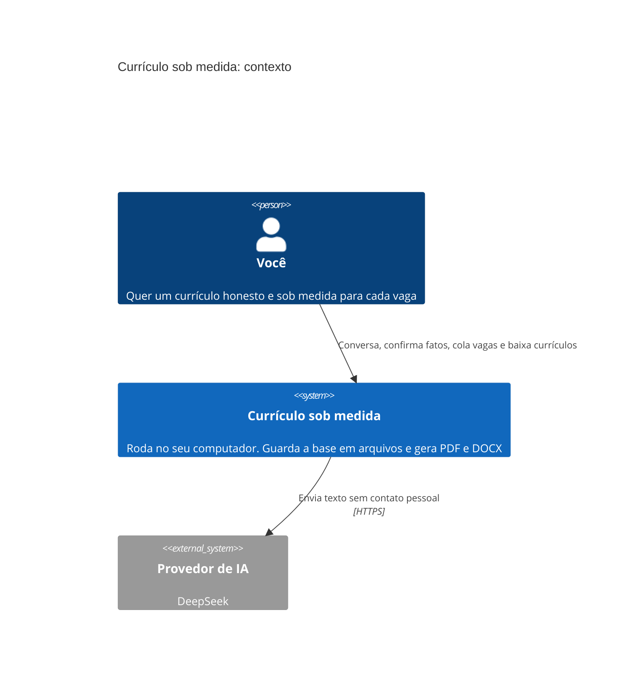

### Contêineres (C4, nível 2)

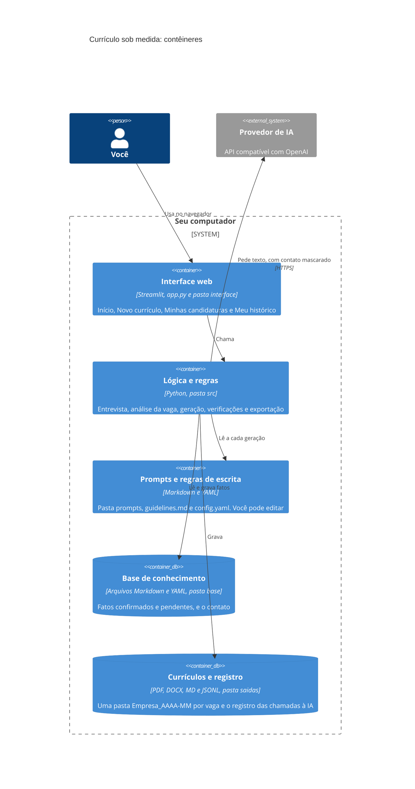

### Componentes (C4, nível 3: pastas `interface` e `src`)

O C4 oficial para este nível usa um diagrama experimental. Aqui está o equivalente em fluxograma, que renderiza em qualquer lugar.

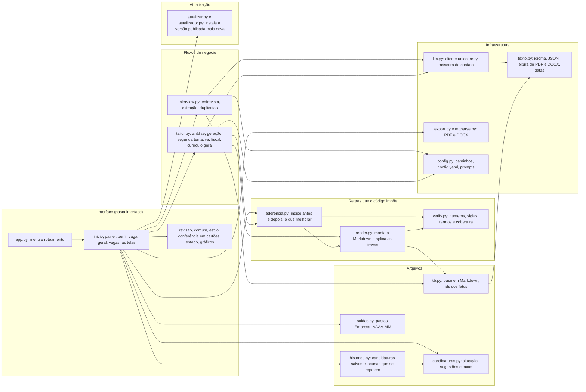

### O que acontece com cada frase do currículo

Esta é a parte mais importante. A IA escreve uma proposta. O **código** decide o que entra.

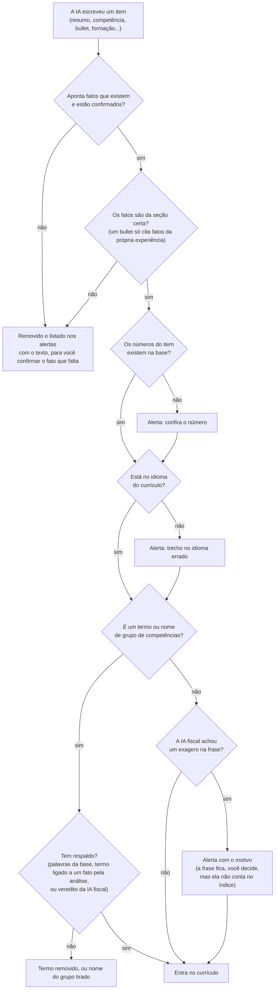

Além disso, o código garante que **empresa, cargo, datas e local vêm sempre da sua base**, nunca da IA, que o título abaixo do nome é um cargo seu (ou o título que você digitar), e que uma experiência que a IA deixar de fora gera aviso.

### Sequência 1: conversa e conferência

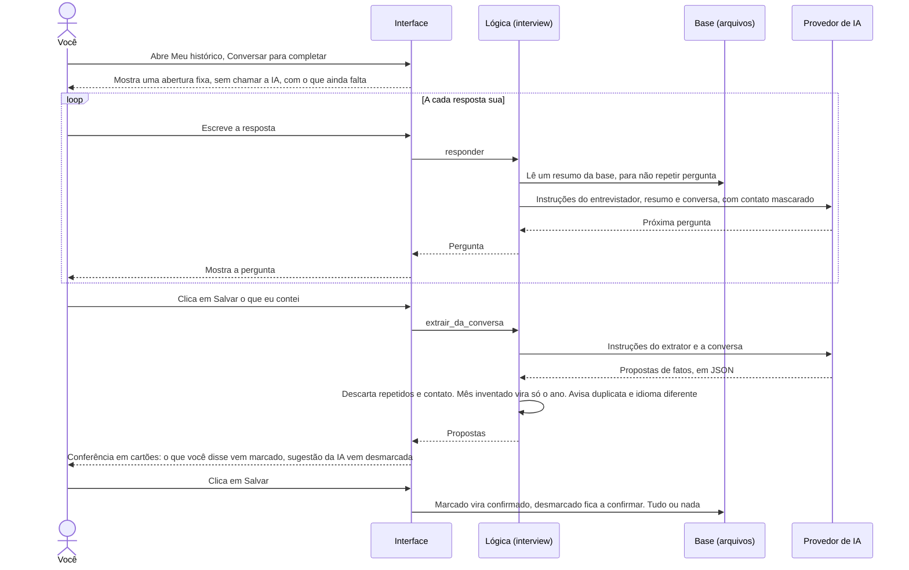

### Sequência 2: ler um currículo existente

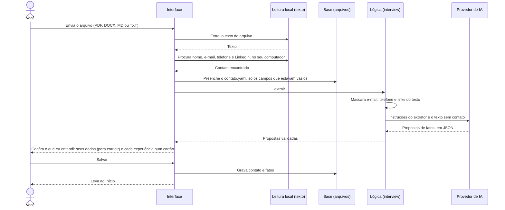

### Sequência 3: analisar a vaga e responder às lacunas

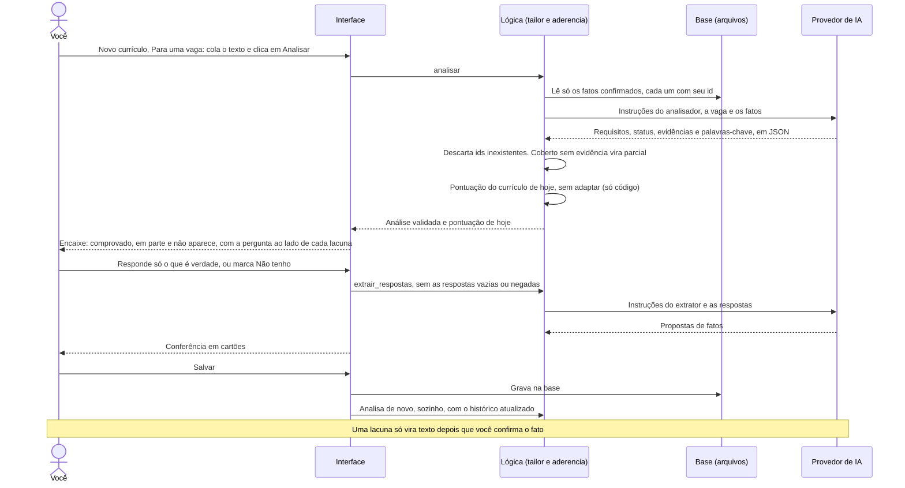

### Sequência 4: gerar o currículo e verificar

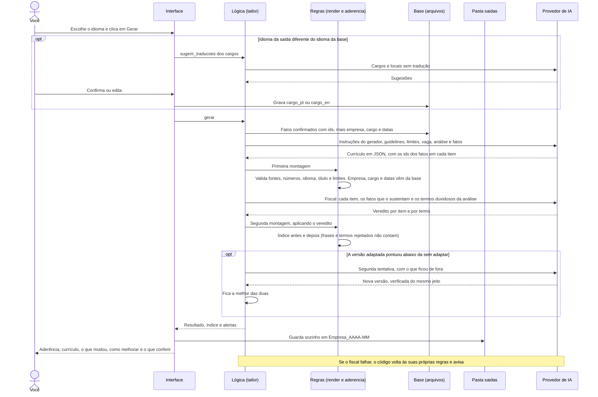

O **currículo geral** (Novo currículo, Geral, sem vaga) segue a mesma sequência a partir de "gerar", com uma análise vazia e o foco no lugar da vaga. Não há índice de aderência, e a pasta é `Geral_AAAA-MM`.

### Sequência 5: exportar e editar

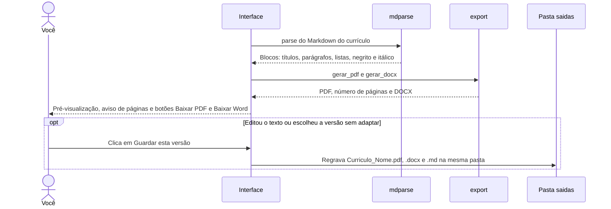

### Sequência 6: acompanhar as candidaturas

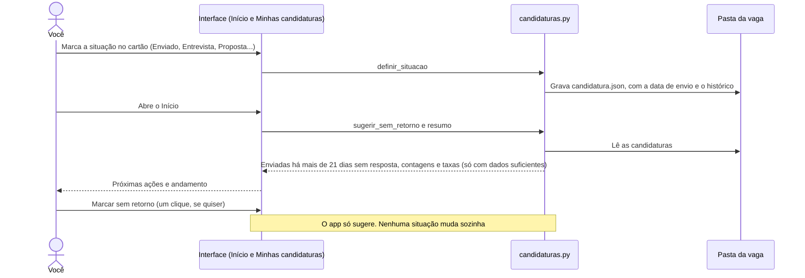

### Sequência 7: atualização automática

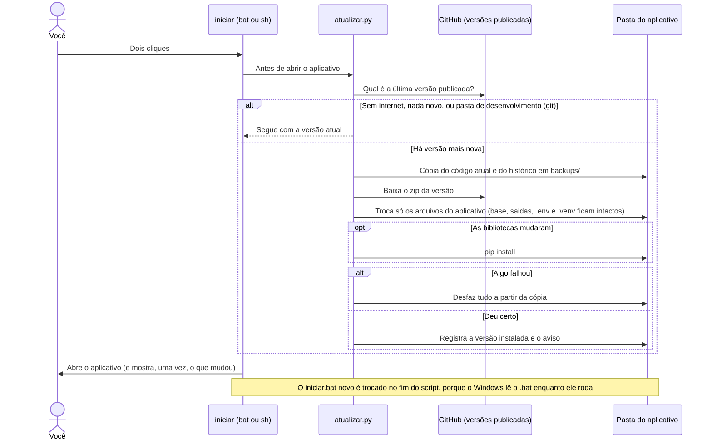

### Como a base é organizada

```text
base/
  contato.yaml         nome, títulos, local, telefone, e-mail, links (nunca vai para a IA)
  perfil.md            objetivo e tipo de vaga que você busca
  habilidades.md  formacao.md  certificacoes.md  idiomas.md
  experiencias/
    empresa-cargo.md   um arquivo por cargo
  .sessao/             conversa e conferências ainda não salvas
```

Um arquivo de experiência tem um cabeçalho e os fatos:

```markdown
---
tipo: experiencia
empresa: Empresa Exemplo
cargo: Analista de Marketing
cargo_en: Marketing Analyst        # opcional: versão para currículos em inglês
inicio: 2022-03                    # AAAA-MM, ou só AAAA se você não lembra o mês
fim: atual                         # AAAA-MM, AAAA ou atual
local: São Paulo, Brasil
ocultar: false                     # true: esta experiência não entra em nenhum currículo
---
- [confirmado] Estruturou o funil de aquisição de um produto com 12 mil usuários ativos.
- [sugerido] Reduziu o custo por lead em cerca de 20%.
```

`[sugerido]` é o que aparece na tela como *a confirmar*: fica guardado, mas fora dos currículos. O id de cada fato é `arquivo#n`, onde n é a posição da linha marcada no arquivo (por exemplo `empresa-cargo#2`). Os ids mudam se você remover um fato, por isso o aplicativo nunca guarda ids entre sessões.

E cada candidatura, em `saidas/`:

```text
saidas/
  QuintoAndar_2026-10/
    Curriculo_Ana_Souza.pdf  .docx  .md   o currículo (com _EN quando em inglês)
    vaga.txt  analise.json                a vaga e a análise
    relatorio.md  indice.json             o que mudou e a aderência
    candidatura.json                      situação, data de envio e anotação
  Geral_2026-10/                          currículo geral (sem candidatura)
  logs/                                   registro das chamadas à IA
```

### Quem garante o quê

| Regra | Quem garante |
|---|---|
| Só fatos `[confirmado]` chegam à IA | Código (`kb.py`) |
| Item sem fato de apoio é removido | Código (`render.py`) |
| Bullet só cita fatos da própria experiência | Código (`render.py`) |
| Empresa, cargo, datas e local vêm da base | Código (`render.py`) |
| Título é um cargo seu ou o que você digitou | Código (`render.py`) |
| Número do texto existe na base (`80 mil` e `80,000` são o mesmo) | Código (`verify.py`) |
| Trecho no idioma errado vira alerta | Código (`render.py`) |
| Mês de uma data só vale se foi dito; sem mês, fica só o ano | Código (`interview.py`) |
| Salvar uma conferência é tudo ou nada | Código (`interview.py`) |
| Experiência parecida com uma existente gera aviso | Código (`interview.py`) |
| Contato nunca vai para a IA | Código (`llm.py`) |
| Termo de competência tem respaldo | Código no mesmo idioma da base, **IA fiscal** quando o currículo é traduzido ou o termo é um sinônimo |
| Frase não exagera o que o fato diz | **IA fiscal** (só alerta, a decisão é sua) |
| O índice não sobe por inventar | Código (`aderencia.py`), usando o veredito da IA fiscal |
| A versão adaptada não fica abaixo da sem adaptar | Código (`tailor.py`): segunda tentativa e aviso |
| Tradução fiel de cargos e nomes | **IA sugere, você confirma** |
| Situação da candidatura | **Você marca**; o código só sugere "Sem retorno" |

A IA fiscal é uma segunda chamada ao modelo. Ela dá um **veredito para cada item** (`ok`, `exagero` ou `sem_respaldo`), confere o resumo e os nomes de grupo de competências, e julga os termos que a análise ligou a fatos com outras palavras ("treinou 15 operadores" não é "gestão de equipes"). O código ainda descarta qualquer apontamento que diga no próprio texto que o item está fiel. Ela reduz o risco, mas **não é prova**: nos testes ela ainda deixou passar exageros leves de vez em quando.

---

## Problemas comuns

| Mensagem ou sintoma | O que fazer |
|---|---|
| "Não encontrei o Python" | Instale em python.org e marque **Add python.exe to PATH**. Feche e abra o `iniciar.bat` de novo. |
| "A chave de API foi recusada" | Confira a chave no `.env`: sem espaços, sem aspas, na linha do provedor certo. |
| "O modelo não existe nesse provedor" | Deixe `MODELO=` em branco no `.env`, ou peça a quem emprestou a chave o nome certo. |
| "Limite de uso do provedor atingido" ou análise muito demorada | O aplicativo já tenta de novo sozinho. Espere cerca de um minuto. Se o DeepSeek estiver fora do ar ou sem saldo, nada funciona até voltar. |
| "Resposta vazia" ou "JSON inválido" | O modelo é fraco demais ou gastou tudo pensando. Tente de novo ou troque de modelo. |
| A análise diz que eu não tenho algo que eu tenho | A análise só enxerga o que está **confirmado**. Confira se você salvou a conferência do currículo lido, se há itens *a confirmar* em Meu histórico e se o histórico tem as experiências, a formação e as habilidades. O aplicativo mostra esses avisos no primeiro passo da vaga. |
| O entrevistador pergunta o que já está no meu currículo | Quase sempre é porque a conferência do currículo lido não foi salva. Salve, e a conversa passa a perguntar só o que falta. |
| "A verificação por IA não rodou" | O currículo saiu sem o segundo passo de conferência. Leia com mais atenção, ou gere de novo. |
| O PDF importado "não tem texto" | É um PDF escaneado (imagem). Envie uma versão em texto ou use DOCX. |
| O PDF passou do limite de páginas | O aplicativo já tenta refazer mais curto. Se o aviso continuar, corte um bullet de uma experiência antiga editando o texto, reduza o espaço dela antes de gerar, ou mude `max_paginas` e `bullets_por_experiencia` no `config.yaml`. |
| A porta 8501 está ocupada | Feche a janela preta de uma execução anterior e abra de novo. |
| Fechei o aplicativo no meio da conversa | Abra de novo. A conversa e as revisões não salvas voltam sozinhas, com um aviso no topo. Para recomeçar do zero, use **Recomeçar a conversa**. |
| Quero ver o que a IA recebeu e respondeu | **Meu histórico**, seção **Avançado**, ou a pasta `saidas/logs`. |
| Quero fazer backup | Copie a pasta `base/`. É tudo o que importa. |
| Quero mais (ou menos) espaço para as experiências antigas | No painel **Espaço de cada experiência**, vaga por vaga, ou no `config.yaml`: `bullets_por_experiencia` (por posição) e `experiencias_antigas` (`anos`, `mais_antigas`, `max_bullets`, `max_bullets_relevante`; `ativo: false` desliga a regra de antiguidade). |
| Quero mudar o jeito que o currículo é escrito | Edite o `guidelines.md` (tom, verbos, estilo) ou o `config.yaml` (limites, ordem e nome das seções). |

---

## Para quem desenvolve

```text
app.py            menu e roteamento (Streamlit), sem lógica de negócio
interface/        as telas: início, painel, histórico, vaga, currículo geral, candidaturas
verificar.py      diagnóstico para rodar na máquina do usuário
iniciar.bat       duplo clique no Windows
iniciar.sh        Linux (e Mac): bash iniciar.sh
atualizar.py      chamado pelo iniciar: instala a versão publicada mais nova (lógica em src/atualizador.py)
VERSAO            número da versão do código; precisa bater com a tag da Release
prompts/          entrevistador, extrator, analisador, gerador, verificador, tradutor_cargos
src/              regras e fluxos: ver o diagrama de componentes acima
tests/            unittest, com LLM falso, sessão HTTP falsa e streamlit falso
exemplo/          base fictícia e duas vagas de exemplo (base/ é copiada com um clique)
config.yaml       limites, ordem das seções e prazos do acompanhamento de candidaturas
guidelines.md     regras de escrita lidas pela IA a cada geração
```

Rodar os testes (não usam rede nem chave):

```bash
python -m unittest discover -s tests -t .
```

Os testes da interface usam um Streamlit falso: simulam cliques e conferem o que é mostrado e gravado, mas não o visual. O comportamento real da tela precisa ser conferido **rodando o aplicativo**. Para testar sem mexer nos seus dados, aponte `CV_BASE_DIR` para uma pasta de teste; lembre que gerar um currículo grava em `saidas/`.

### Publicar uma versão nova (atualização automática)

A instalação dela só recebe **versões publicadas** (Releases do GitHub), nunca cada mudança na `main`. Para publicar:

1. Na `main` já com tudo mesclado, troque o número no arquivo `VERSAO` (por exemplo, de `v1.0.0` para `v1.1.0`), faça commit e envie.
2. Crie a Release com a **mesma tag**. As notas aparecem para ela dentro do aplicativo: escreva em português simples, pensando nela.

```bash
gh release create v1.1.0 --title "v1.1.0" --notes "Início novo, acompanhamento de candidaturas e currículo geral."
```

Ou pelo site: **Releases**, **Draft a new release**, tag `v1.1.0`, título e notas, **Publish release**.

A comparação é por número (`v1.10.0` é mais nova que `v1.9.3`). O atualizador não roda numa pasta com `.git` (a sua, de desenvolvimento) e pode ser desligado com `CV_NAO_ATUALIZAR=1`. Ele guarda em `.manifesto` a lista de arquivos de cada versão, para apagar na próxima os que saíram; `backups/`, `.versao_instalada`, `.manifesto` e `.atualizacao.json` ficam fora do Git.

### Antes de subir para o GitHub

O `.gitignore` já impede que subam a pasta `base/`, a pasta `saidas/`, o `.env`, qualquer `.pdf` ou `.docx`, e as vagas reais de teste (só `vaga_pt.txt` e `vaga_en.txt` ficam). Confira antes de cada push:

```bash
git status
git ls-files          # nada pessoal deve aparecer aqui
```

Se você guardar currículos reais na pasta `exemplo/` para testar, eles ficam fora do Git, mas continuam no seu computador. Apague-os se compartilhar a pasta por outro meio.

O `.gitattributes` garante fim de linha LF no `iniciar.sh` e CRLF no `iniciar.bat`. Para o `iniciar.sh` ser executável direto no Linux depois de clonar: `chmod +x iniciar.sh` (ou use `bash iniciar.sh`).

Cada chamada à IA é registrada em `saidas/logs/AAAA-MM-DD.jsonl`, uma linha por chamada, com `rotulo` (entrevistador, extrator, analisador, gerador, verificador, tradutor_cargos), modelo, duração, o que foi enviado **já mascarado** (sem telefone, e-mail, links nem os dados do contato), a resposta recebida e o erro, se houve. Serve para depurar e para melhorar os prompts: abra o arquivo, ache a chamada que deu errado e veja exatamente o que o modelo recebeu e respondeu. **Meu histórico**, seção **Avançado**, mostra as últimas chamadas e permite baixar o registro do dia. A chave de API nunca é gravada. Para desligar, coloque `CV_LOG=0` no `.env`. **O registro contém o conteúdo da sua base e das suas conversas: apague a pasta `saidas/logs` antes de compartilhar o computador.**

A conversa em andamento e as revisões de fatos ainda não salvas ficam em `base/.sessao/sessao.json` e voltam quando o aplicativo abre de novo. O arquivo some quando não há mais nada pendente.

---

## Escolhas registradas

Decisões que o briefing original não cobria, tomadas durante o desenvolvimento:

- **Fonte restrita por seção.** Um bullet só pode citar fatos da própria experiência. Formação, certificações e idiomas só citam o arquivo correspondente.
- **IA fiscal em uma segunda chamada**, em vez de confiar só no filtro de palavras, porque palavras não são comparáveis entre idiomas.
- **Mês de data nunca é completado pela IA.** Se você só disse o ano, o campo fica em branco para você preencher.
- **Tradução de cargos com confirmação.** A IA sugere, nada é gravado sem você confirmar. Campos `cargo_pt`, `cargo_en`, `local_pt` e `local_en`.
- **Bases em um idioma só.** O aplicativo avisa se a base mistura português e inglês, porque as verificações dependem do idioma dominante. Um currículo importado em outro idioma que a base gera aviso, e uma experiência com a mesma empresa e o mesmo início de uma existente gera alerta na revisão. O aplicativo não junta experiências sozinho: a decisão de descartar ou aproveitar é sua.
- **Instituições de ensino são traduzidas** para o idioma do currículo. Empresas, produtos e certificações não.
- **Tempo verbal do cargo atual é livre**, desde que consistente dentro de cada experiência.
- **Palavras-chave sustentadas vêm da análise, com os fatos.** O gerador só recebe o vocabulário da vaga para os termos que a base comprova (ids de fatos validados pelo código). Os demais vão numa lista "não use".
- **O relatório separa o que o código prova do que a IA conta**, e a correspondência de termos aceita singular e plural.
- **Espaço por experiência decidido pelo código e ajustável.** Parte de um limite por posição (mais recente, mais espaço). Experiências antigas (terminaram há mais de 10 anos, ou as 2 mais antigas de um histórico com ao menos 3 recentes) ficam com 1 bullet, a menos que a análise da vaga as torne relevantes (peso 2: um requisito obrigatório ou dois desejáveis apoiados nelas), caso em que ganham até 3. Recentes relevantes ganham 1 a mais, até o limite da mais recente. Limite 0 mostra só cargo, empresa e datas e não gera alerta de "buraco" no histórico, porque foi escolha sua. O modelo recebe o limite de cada experiência e a instrução de escrever um resumo denso quando o limite é baixo.
- **Índice de aderência próprio, nunca "nota de ATS".** Só conta palavra-chave que a base sustenta e requisito cujo fato de apoio está no texto, então inventar não sobe o número. O "antes" é o currículo-base montado sem IA. Quando vaga e currículo estão em idiomas diferentes, as palavras-chave são estimadas pelos fatos usados, e isso é dito na tela.
- **Histórico em arquivos.** `indice.json` ao lado de cada currículo salvo; a área Minhas candidaturas lê a pasta `saidas/`, uma pasta `Empresa_AAAA-MM` por candidatura, gravada sozinha a cada geração. Currículos salvos antes deste recurso aparecem sem índice.
- **Interface guiada.** Primeiro uso começa pelo currículo existente; depois, o Início (o que fazer agora) e as áreas Novo currículo, Minhas candidaturas e Meu histórico. Conferências em cartões, com tudo à vista, e um botão só para salvar: desmarcado fica guardado *a confirmar*. A vaga em três passos, só o atual aberto.
- **A versão adaptada não pode ficar abaixo da original.** A pontuação do currículo sem adaptar aparece antes de gerar. Se a versão adaptada pontuar menos, o gerador recebe uma segunda chance com a lista do que deixou de fora, e fica a melhor das duas. Se mesmo assim ficar abaixo, a tela avisa e oferece **Usar a versão sem adaptar**. O "original" é o currículo montado com o histórico confirmado, não o arquivo enviado: só ele tem a ligação de cada frase com uma informação confirmada, e sem isso a comparação não seria justa.
- **Termos duvidosos passam pelo fiscal.** Palavra-chave que a análise deu como comprovada, mas que as informações citadas não dizem com as mesmas palavras ("treinou 15 operadores" e "gestão de equipes"), é julgada pelo fiscal por IA na mesma chamada. Se ele não confirma, o termo não conta no índice nem fica nas competências. Termo que está escrito no histórico conta mesmo se a análise esquecer dele.
- **Acompanhamento de candidaturas com um clique e sem automação.** A situação é marcada pela pessoa; o aplicativo só sugere "Sem retorno" depois de 21 dias (`config.yaml`, bloco `candidaturas`). Nada de integração com e-mail ou LinkedIn: exigiria login, servidor e dados de terceiros, e o aplicativo roda só no computador dela.
- **Taxas só com dados suficientes.** Taxa de resposta a partir de 5 candidaturas enviadas; relação entre aderência e resultado a partir de 20, rotulada como indício. Com menos, os números mudam demais a cada resposta e pareceriam conclusão.
- **Currículo geral com foco opcional.** Sem nenhum alvo, um currículo tende a não servir para nada; o foco (ou o objetivo do histórico) orienta o que vem primeiro. Não tem índice de aderência, porque não há vaga.
- **Atualização automática só de versões publicadas.** O `iniciar` instala sozinho a Release mais nova, sem perguntar, porque uma pergunta na janela preta confunde quem não usa terminal. Antes, guarda cópia do código e do histórico; qualquer falha desfaz a troca. Atualizar a cada mudança na `main` foi descartado: um merge para testar viraria atualização na máquina dela. O código baixado vem do repositório do responsável: vale manter a verificação em duas etapas ligada na conta do GitHub.
- **Limite de 2 páginas.** É o limite mais comum para currículos no Brasil, e você muda em `max_paginas` no `config.yaml`. Passar do limite derruba a nota de Formato, então o aplicativo condensa o texto em vez de cortar palavras-chave. O número de bullets pouco mexe na nota, porque as palavras-chave também entram no resumo e nas competências: bullets servem a quem lê, e o custo deles é espaço.
- **Feito para a tela do computador.** No celular funciona, mas o menu de cima não cabe inteiro.
- **Datas só com ano são aceitas.** Currículo real costuma ter "2016 – 2017". Exigir o mês obrigaria a pessoa a inventar um.
- **Salvar é tudo ou nada.** Se uma experiência nova tem um problema (data inválida, empresa vazia), nada é gravado e a tela diz o que corrigir.
- **Duplicatas por semelhança.** Experiência nova com empresa de nome parecido ou no mesmo período de uma existente gera aviso na conferência. O app não junta nada sozinho.
- **Termos aceitos pela análise valem em todo o currículo.** Um sinônimo que a análise ligou a uma informação do histórico passa no filtro das competências também, e o fiscal por IA confere. Nomes de grupo de competências também passam pelo fiscal.
- **Extrator conservador.** Só o que você afirmou vem marcado. Qualquer origem desconhecida conta como sugestão.
- **Sem banco de dados, login ou servidor.** Tudo em arquivos locais.

## Licença

[MIT](LICENSE). Você pode usar, copiar e modificar o código, mantendo o aviso de copyright. O software é entregue como está, sem garantia: **o currículo gerado é responsabilidade de quem o envia**, e a IA pode errar mesmo com as travas do aplicativo.
