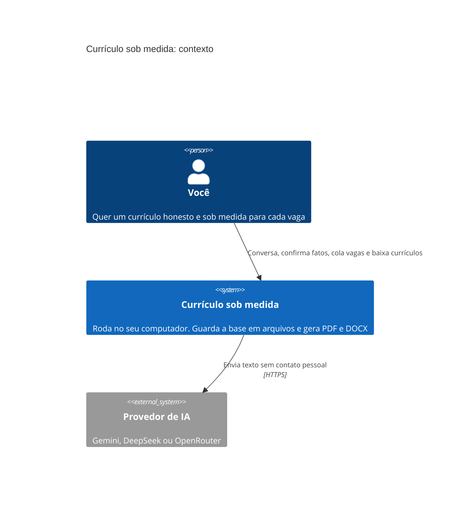
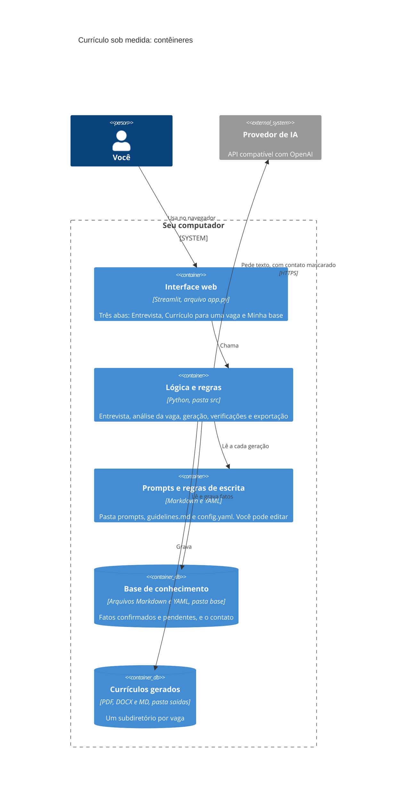
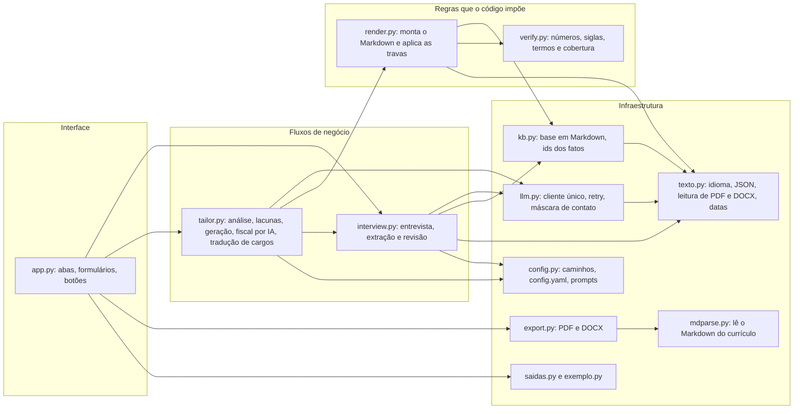
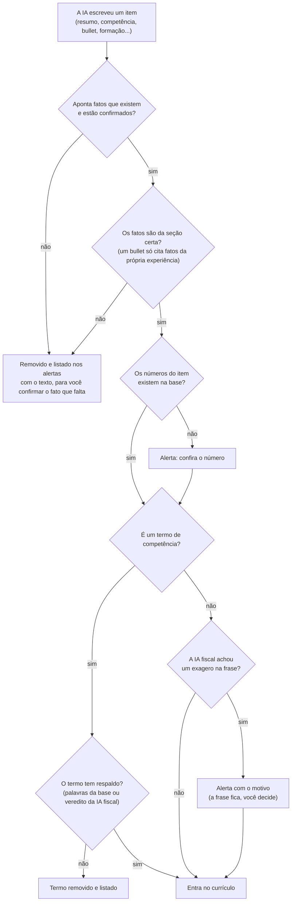
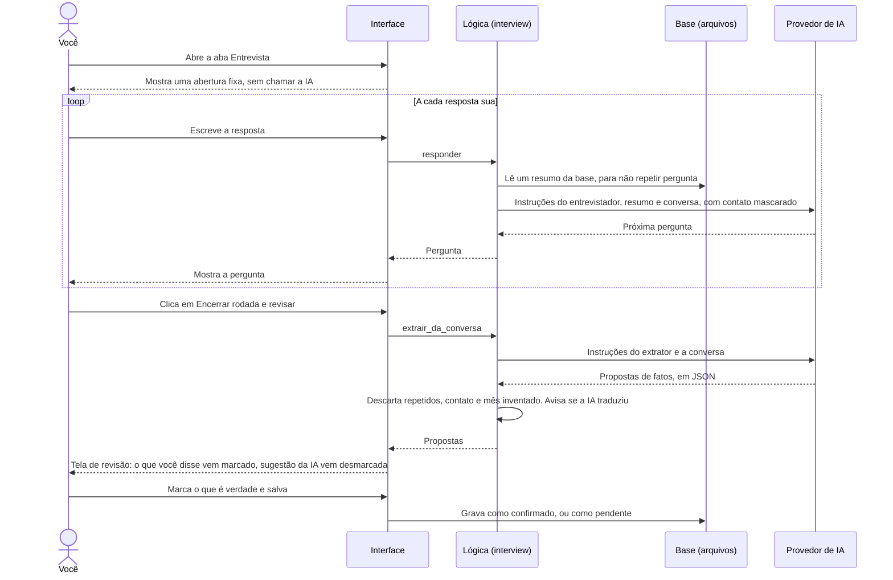
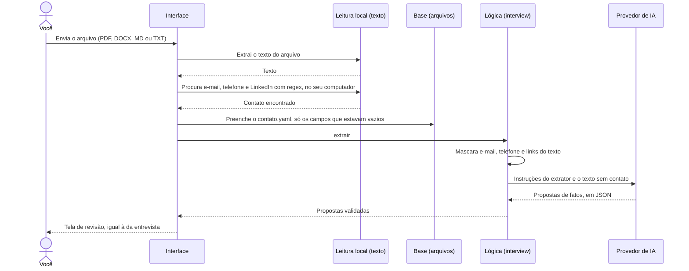
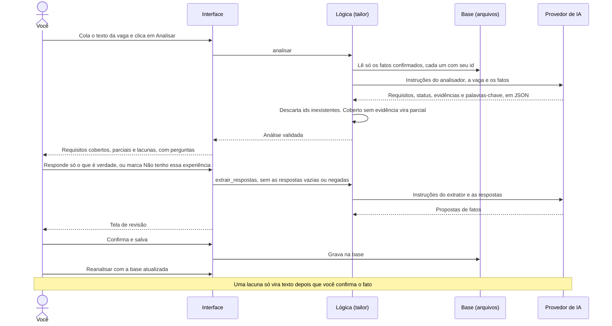
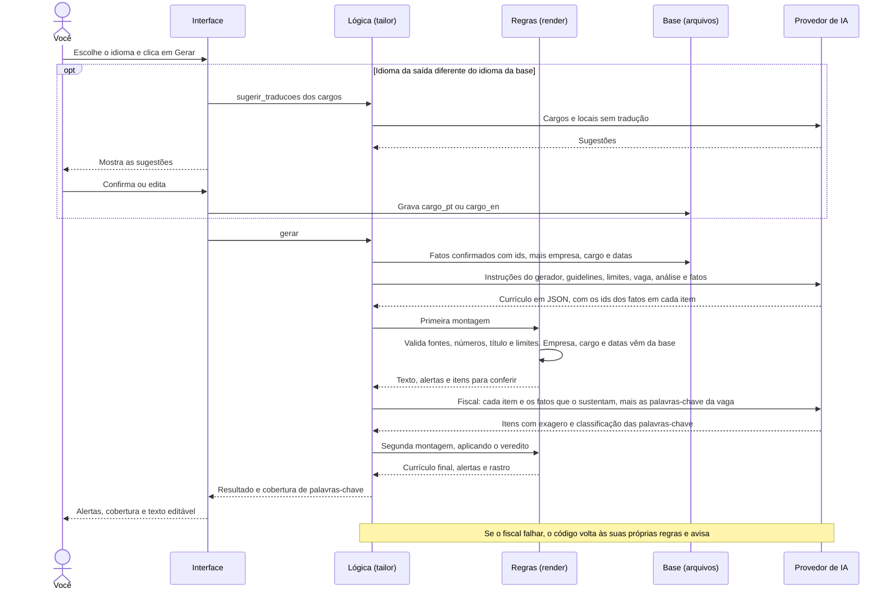
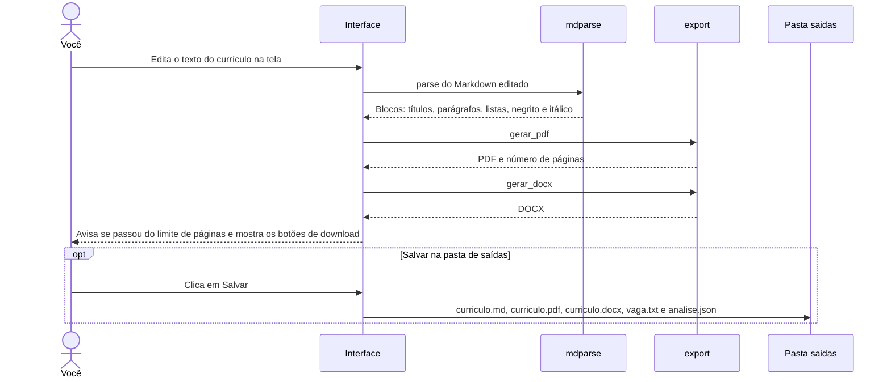

# Currículo sob medida

Um aplicativo que roda **no seu computador** e faz duas coisas:

1. **Entrevista você** por chat para descobrir, com precisão, o que você já fez na vida profissional, e guarda isso numa base de fatos em arquivos de texto.
2. **Monta um currículo para cada vaga.** Você cola a descrição da vaga, o aplicativo mostra o que a sua base comprova e o que é lacuna, pergunta o que falta e gera o currículo em português ou inglês, em PDF e DOCX, com formatação simples para sistemas de triagem (ATS).

A regra central do projeto, imposta por código e não só pedida à IA:

> **Nada entra no currículo sem um fato que você confirmou.** A IA pode sugerir, reformular e traduzir. Só você decide o que é verdade.

## O que ele não faz

- **Não promete que o currículo vai passar em nenhum ATS.** O que ajuda de verdade é usar o vocabulário exato da vaga nos pontos em que ele é verdade para você, e um recrutador de carne e osso ainda lê o resultado.
- **Não inventa experiência para cobrir uma lacuna.** Se a vaga pede algo que você não tem, o aplicativo mostra a lacuna e deixa de fora do currículo.
- **Não baixa vagas por link.** Os sites bloqueiam isso. Copie e cole o texto da vaga.
- **Não é infalível.** A IA pode errar mesmo com as travas. Leia o currículo inteiro e os alertas antes de enviar.

## Privacidade: o que sai do seu computador

| Fica só no seu computador | É enviado ao provedor de IA |
|---|---|
| Nome, telefone, e-mail, links e endereço (arquivo `base/contato.yaml`) | O que você escreve no chat |
| A sua base de fatos (pasta `base/`) | Os fatos confirmados que o aplicativo usa para analisar e gerar |
| Os currículos gerados (pasta `saidas/`) | O texto da vaga e do currículo importado |
| A sua chave de API (arquivo `.env`) | |

Antes de qualquer envio, o aplicativo **mascara e-mails, telefones e links** e remove do texto os valores do seu cadastro de contato (incluindo o seu nome). O cabeçalho do currículo é montado localmente, depois da geração. Mesmo assim, **não digite telefone, endereço ou documentos no chat.**

Cada provedor trata o que recebe de um jeito. Escolha sabendo disso:

| Provedor | O que saber |
|---|---|
| **Gemini, plano gratuito** | O Google pode usar prompts e respostas para melhorar os produtos dele fora do Reino Unido, da Suíça e do Espaço Econômico Europeu. **O Brasil está fora dessa proteção.** No plano pago a regra é outra, confira nos termos do Google. |
| **DeepSeek** | Os servidores ficam na China. |
| **OpenRouter** | Depende do modelo e de quem o hospeda. Modelos gratuitos e mais fracos também inventam mais, o que é o pior risco para um currículo. |

---

## Instalação, sem usar terminal

Você precisa de internet na primeira vez (para baixar as peças do aplicativo) e de uma **chave de API** (veja a próxima seção).

### Windows

1. **Instale o Python.** Entre em [python.org/downloads](https://www.python.org/downloads/), baixe a versão mais recente e abra o instalador. Na **primeira tela**, antes de clicar em *Install Now*, marque a caixa **"Add python.exe to PATH"**. Esse é o passo que mais dá problema quando esquecido.
2. **Baixe o aplicativo.** Na página do projeto no GitHub, clique no botão verde **Code** e depois em **Download ZIP**. Clique com o botão direito no arquivo baixado, escolha **Extrair tudo** e deixe a pasta num lugar fácil, como Documentos.
3. **Pegue a chave** do provedor escolhido (próxima seção).
4. **Dê dois cliques em `iniciar.bat`.**
   - Na primeira vez, ele prepara tudo sozinho. Isso leva alguns minutos.
   - Se o Windows mostrar "O Windows protegeu seu computador", clique em **Mais informações** e depois em **Executar assim mesmo**. O arquivo é só texto: dá para abrir no Bloco de Notas e ler antes.
5. **Cole a chave.** O Bloco de Notas abre com o arquivo `.env`. Escreva o provedor e cole a chave depois do sinal de `=`, como no exemplo abaixo. Salve e feche o Bloco de Notas.
6. O navegador abre sozinho com o aplicativo. **Para encerrar, feche a janela preta.**

Nas próximas vezes, basta dar dois cliques em `iniciar.bat`.

### Linux

```bash
sudo apt install python3 python3-venv python3-pip   # ou o equivalente da sua distribuição
bash iniciar.sh
```

Na primeira execução o script cria o arquivo `.env` e abre um editor. Cole a chave, salve e rode `bash iniciar.sh` de novo.

### Mac

Não há script próprio, e eu não testei em Mac. `bash iniciar.sh` deve funcionar depois de instalar o Python em python.org.

### Conferir se está tudo certo

Numa janela de terminal na pasta do aplicativo:

```bash
python verificar.py            # Windows: .venv\Scripts\python verificar.py
python verificar.py --modelos  # lista os modelos que a sua chave enxerga
```

Ele confere o Python, os pacotes, as pastas, a geração de PDF e DOCX, a conexão com o provedor e se o modelo devolve JSON. Cada problema aparece como `[FALHOU]`, com a dica do que fazer.

---

## Escolhendo o provedor e pegando a chave

| | Gemini | DeepSeek | OpenRouter |
|---|---|---|---|
| Custo | Plano gratuito, com limite baixo por minuto | Pago, muito barato (um currículo custa centavos) | Modelos `:free` ou pagos |
| Onde pegar a chave | [aistudio.google.com/apikey](https://aistudio.google.com/apikey) | [platform.deepseek.com/api_keys](https://platform.deepseek.com/api_keys) | [openrouter.ai/keys](https://openrouter.ai/keys) |
| Modelo padrão | `gemini-3.8-flash` | `deepseek-flash` | nenhum: você precisa escrever `MODELO=` |
| Cuidado | Dados podem ser usados pelo Google (veja Privacidade) | Servidores na China | Modelos gratuitos inventam mais |

Os nomes de modelos mudam com o tempo. Se der erro de "modelo não existe", rode `python verificar.py --modelos` e copie um nome da lista para a linha `MODELO=` do `.env`.

Exemplo de `.env` (só a chave do provedor que você usa precisa estar preenchida):

```ini
PROVEDOR=deepseek
DEEPSEEK_API_KEY=cole_a_chave_aqui
MODELO=
```

**Nunca compartilhe o `.env`.** Ele é ignorado pelo Git de propósito.

---

## Usando o aplicativo, passo a passo

O aplicativo tem três abas.

### 3. Minha base (comece por aqui, ou pela entrevista)

É a sua base de conhecimento. Preencha o **contato** (nome, telefone, e-mail, links). Esses dados só entram no cabeçalho do currículo e nunca vão para a IA. Aqui você também confirma ou remove os **fatos pendentes**, edita os arquivos e cria experiências à mão.

Cada fato é uma linha de texto com uma marca:

```text
- [confirmado] Estruturou o funil de aquisição de um produto com 12 mil usuários ativos.
- [sugerido] Reduziu o custo por lead em cerca de 20% (estimativa, confirmar como foi medido).
```

Só `[confirmado]` chega à IA e ao currículo. `[sugerido]` fica guardado até você confirmar ou remover. Linhas sem marca são ignoradas, e o aplicativo avisa quantas existem.

### 1. Entrevista

1. *(Opcional)* Em **Importar um currículo existente**, envie o seu currículo atual (PDF, DOCX, MD ou TXT). Isso acelera a entrevista. Seu telefone, e-mail e LinkedIn são lidos no seu computador e vão para a aba Minha base, sem passar pela IA.
2. **Converse.** O entrevistador faz uma pergunta por vez, da experiência mais recente para a mais antiga. Ele pede exemplos e números. Se você só tem uma estimativa, diga que é estimativa.
3. Clique em **Encerrar rodada e revisar.** Você verá a lista de fatos que a IA entendeu.
   - Fatos que **você disse** vêm marcados.
   - Fatos que **a IA inferiu** vêm desmarcados. Marque só se for verdade.
4. Salve com **Salvar marcados como confirmados**, ou com **Salvar marcados e guardar o resto como pendente**.

Se a IA completar uma data que você não disse (por exemplo, o mês), o aplicativo apaga o mês e pede que você preencha.

### 2. Currículo para uma vaga

1. **Cole o texto da vaga** (ou envie um arquivo) e clique em **Analisar vaga.** Você verá cada requisito como `coberto`, `parcial` ou `lacuna`, mais as palavras-chave da vaga.
2. **Lacunas.** Para cada requisito sem prova na base, há uma pergunta. Responda **só o que for verdade**. Se você não tem a experiência, marque *Não tenho essa experiência*. Salve as respostas (elas passam pela mesma tela de revisão) e use **Reanalisar com a base atualizada**.
3. **Idioma.** O aplicativo recomenda o idioma da vaga, mas a escolha é sua. Se o idioma for diferente do idioma da sua base, ele sugere a tradução dos cargos e você confirma ou edita cada uma.
4. **Gerar currículo.** Aparecem os alertas, a cobertura de palavras-chave e o texto do currículo, que você pode **editar**. O PDF e o DOCX saem do texto que está na tela.
5. **Baixe** o PDF, o DOCX ou o Markdown, ou use **Salvar na pasta de saídas** (cria `saidas/data-empresa-vaga/` com o currículo, a vaga e a análise).

### Como ler os alertas e a cobertura

| O que aparece | O que significa |
|---|---|
| *Removido por não ter fato confirmado de apoio* | A IA escreveu algo que nenhum fato seu sustenta. Saiu do currículo. Se for verdade, confirme o fato na aba Minha base. |
| *Número não aparece na base* | Um número do texto não existe nos seus fatos. Confira antes de usar. |
| *A verificação por IA aponta algo sem respaldo* | Um segundo passo de IA achou um exagero (por exemplo, "fluente" onde você escreveu "avançado"). A frase continua no texto, mas você é avisado. |
| *Competências removidas* | Termos que nenhum fato sustenta saíram da lista de competências. |
| *Cargos sem versão no idioma* | Falta confirmar a tradução de algum cargo. |
| *Experiência ficou de fora* | A IA não aproveitou uma experiência. Isso pode deixar um buraco no seu histórico. |
| **Cobertura de palavras-chave** | `Usadas`: estão no currículo e a base sustenta. `A base tem, mas não usou`: dá para incluir editando. `Ficaram de fora por falta de base`: você não comprovou, e é assim que deve ser, a menos que responda nas lacunas. |

---

## Como funciona, em diagramas

Os diagramas abaixo aparecem desenhados no GitHub. Se você estiver lendo em outro lugar e vir só código, abra o arquivo no GitHub.

### Visão geral (C4, nível 1: contexto)



### Contêineres (C4, nível 2)



### Componentes (C4, nível 3: dentro da pasta `src`)

O C4 oficial para este nível usa um diagrama experimental. Aqui está o equivalente em fluxograma, que renderiza em qualquer lugar.



### O que acontece com cada frase do currículo

Esta é a parte mais importante. A IA escreve uma proposta. O **código** decide o que entra.



Além disso, o código garante que **empresa, cargo, datas e local vêm sempre da sua base**, nunca da IA, que o título abaixo do nome é um cargo seu (ou o título que você digitar), e que uma experiência que a IA deixar de fora gera aviso.

### Sequência 1: entrevista e revisão



### Sequência 2: importar um currículo existente



### Sequência 3: analisar a vaga e responder as lacunas



### Sequência 4: gerar o currículo e verificar



### Sequência 5: exportar



### Como a base é organizada

```text
base/
  contato.yaml         nome, títulos, local, telefone, e-mail, links (nunca vai para a IA)
  perfil.md            objetivo e tipo de vaga que você busca
  habilidades.md  formacao.md  certificacoes.md  idiomas.md
  experiencias/
    empresa-cargo.md   um arquivo por cargo
```

Um arquivo de experiência tem um cabeçalho e os fatos:

```markdown
---
tipo: experiencia
empresa: Empresa Exemplo
cargo: Analista de Marketing
cargo_en: Marketing Analyst        # opcional: versão para currículos em inglês
inicio: 2022-03                    # AAAA-MM
fim: atual                         # AAAA-MM ou atual
local: São Paulo, Brasil
ocultar: false                     # true: esta experiência não entra em nenhum currículo
---
- [confirmado] Estruturou o funil de aquisição de um produto com 12 mil usuários ativos.
```

O id de cada fato é `arquivo#n`, onde n é a posição da linha marcada no arquivo (por exemplo `empresa-cargo#2`). Os ids mudam se você remover um fato, por isso o aplicativo nunca guarda ids entre sessões.

### Quem garante o quê

| Regra | Quem garante |
|---|---|
| Só fatos `[confirmado]` chegam à IA | Código (`kb.py`) |
| Item sem fato de apoio é removido | Código (`render.py`) |
| Bullet só cita fatos da própria experiência | Código (`render.py`) |
| Empresa, cargo, datas e local vêm da base | Código (`render.py`) |
| Título é um cargo seu ou o que você digitou | Código (`render.py`) |
| Número do texto existe na base (`80 mil` e `80,000` são o mesmo) | Código (`verify.py`) |
| Mês de uma data só vale se foi dito | Código (`interview.py`) |
| Contato nunca vai para a IA | Código (`llm.py`) |
| Termo de competência tem respaldo | Código no mesmo idioma da base, **IA fiscal** quando o currículo é traduzido |
| Frase não exagera o que o fato diz | **IA fiscal** (só alerta, a decisão é sua) |
| Tradução fiel de cargos e nomes | **IA sugere, você confirma** |

A IA fiscal é uma segunda chamada ao modelo. Ela reduz o risco, mas **não é prova**: nos testes ela errou para o lado seguro (removeu um termo bom em vez de deixar passar um inventado), mas a amostra é pequena.

---

## Problemas comuns

| Mensagem ou sintoma | O que fazer |
|---|---|
| "Não encontrei o Python" | Instale em python.org e marque **Add python.exe to PATH**. Feche e abra o `iniciar.bat` de novo. |
| "A chave de API foi recusada" | Confira a chave no `.env`: sem espaços, sem aspas, na linha do provedor certo. |
| "O modelo não existe nesse provedor" | Rode `python verificar.py --modelos` e use um nome da lista em `MODELO=`. |
| "Limite de uso do provedor atingido" | No plano gratuito o limite por minuto é baixo. O aplicativo já tenta de novo sozinho. Espere cerca de um minuto. |
| "Resposta vazia" ou "JSON inválido" | O modelo é fraco demais ou gastou tudo pensando. Tente de novo ou troque de modelo. |
| "A verificação por IA não rodou" | O currículo saiu sem o segundo passo de conferência. Leia com mais atenção, ou gere de novo. |
| O PDF importado "não tem texto" | É um PDF escaneado (imagem). Envie uma versão em texto ou use DOCX. |
| O PDF passou do limite de páginas | Corte conteúdo editando, ou mude `max_paginas` e `bullets_por_experiencia` no `config.yaml`. |
| A porta 8501 está ocupada | Feche a janela preta de uma execução anterior e abra de novo. |
| Quero fazer backup | Copie a pasta `base/`. É tudo o que importa. |
| Quero mudar o jeito que o currículo é escrito | Edite o `guidelines.md` (tom, verbos, estilo) ou o `config.yaml` (limites, ordem e nome das seções). |

---

## Para quem desenvolve

```text
app.py            interface Streamlit, fina, sem lógica de negócio
verificar.py      diagnóstico para rodar na máquina do usuário
iniciar.bat       duplo clique no Windows
iniciar.sh        Linux (e Mac): bash iniciar.sh
prompts/          entrevistador, extrator, analisador, gerador, verificador, tradutor_cargos
src/              ver o diagrama de componentes acima
tests/            unittest, com LLM falso, sessão HTTP falsa e streamlit falso
exemplo/          base fictícia e duas vagas de exemplo (base/ é copiada com um clique)
config.yaml       limites e ordem das seções
guidelines.md     regras de escrita lidas pela IA a cada geração
```

Rodar os testes (não usam rede nem chave):

```bash
python -m unittest discover -s tests -t .
```

O teste do `app.py` usa um Streamlit falso e só pega erro de import, de nome e de desempacotamento. O comportamento real da tela precisa ser conferido **rodando o aplicativo**.

### Antes de subir para o GitHub

O `.gitignore` já impede que subam a pasta `base/`, a pasta `saidas/`, o `.env`, qualquer `.pdf` ou `.docx`, e as vagas reais de teste (só `vaga_pt.txt` e `vaga_en.txt` ficam). Confira antes de cada push:

```bash
git status
git ls-files          # nada pessoal deve aparecer aqui
```

Se você guardar currículos reais na pasta `exemplo/` para testar, eles ficam fora do Git, mas continuam no seu computador. Apague-os se compartilhar a pasta por outro meio.

O `.gitattributes` garante fim de linha LF no `iniciar.sh` e CRLF no `iniciar.bat`. Para o `iniciar.sh` ser executável direto no Linux depois de clonar: `chmod +x iniciar.sh` (ou use `bash iniciar.sh`).

Para depurar, defina `CV_DEBUG=1` antes de rodar: o aplicativo grava em `saidas/debug.log` exatamente o que é enviado ao provedor, para você conferir que não há contato. **Esse arquivo contém o conteúdo da sua base, apague depois.**

---

## Escolhas registradas

Decisões que o briefing original não cobria, tomadas durante o desenvolvimento:

- **Fonte restrita por seção.** Um bullet só pode citar fatos da própria experiência. Formação, certificações e idiomas só citam o arquivo correspondente.
- **IA fiscal em uma segunda chamada**, em vez de confiar só no filtro de palavras, porque palavras não são comparáveis entre idiomas.
- **Mês de data nunca é completado pela IA.** Se você só disse o ano, o campo fica em branco para você preencher.
- **Tradução de cargos com confirmação.** A IA sugere, nada é gravado sem você confirmar. Campos `cargo_pt`, `cargo_en`, `local_pt` e `local_en`.
- **Bases em um idioma só.** O aplicativo avisa se a base mistura português e inglês, porque as verificações dependem do idioma dominante.
- **Instituições de ensino são traduzidas** para o idioma do currículo. Empresas, produtos e certificações não.
- **Tempo verbal do cargo atual é livre**, desde que consistente dentro de cada experiência.
- **Extrator conservador.** Só o que você afirmou vem marcado. Qualquer origem desconhecida conta como sugestão.
- **Sem banco de dados, login ou servidor.** Tudo em arquivos locais.

## Licença

Defina a licença antes de publicar. Sem um arquivo `LICENSE`, ninguém além de você tem permissão de uso por padrão.
